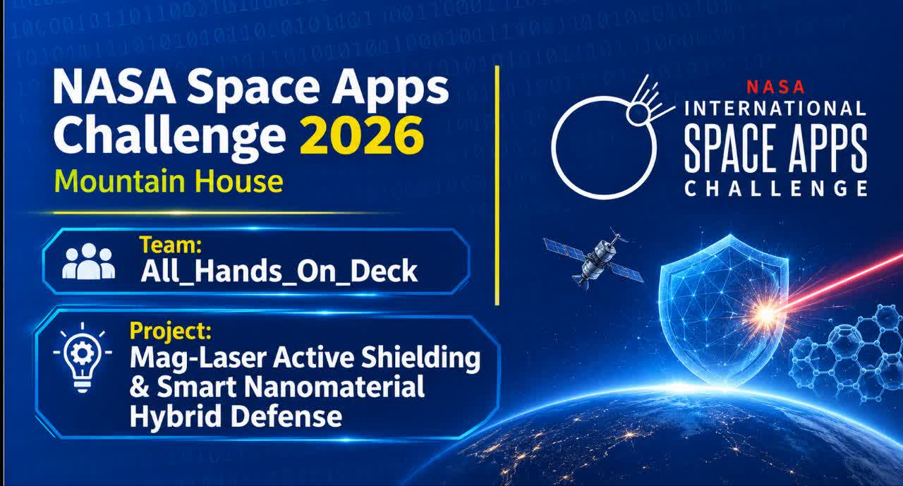

# ALL HANDS ON DECK

### INTERNATIONAL RESEARCH & ENGINEERING TEAM

**NASA Space Apps Challenge 2026 · Baghdad**

*Building Ideas. Engineering Solutions. Exploring Beyond Boundaries.*

 

 

[🌌 About Us](#-who-we-are) • [🚀 Featured Project](#-featured-project) • [👥 Our Team](#-our-team) • [💻 Technology](#-technology-stack) • [🔬 Research](#-research--technical-approach)

 

---

## 🌌 Who We Are

**All Hands On Deck** is an international student research and engineering team participating in the **NASA Space Apps Challenge 2026**.

We bring together different skills, perspectives, and areas of interest, including programming, engineering, scientific research, technology, and creative problem-solving.

Our team focuses on transforming ambitious ideas into structured projects through technical development, conceptual system design, interactive visualization, and collaborative research.

We believe innovation has no borders, and meaningful progress begins when curiosity meets collaboration.

## 🎯 Our Mission

Our mission is to explore challenging scientific and technological problems and develop innovative concepts through research, engineering, and software development.

We aim to:

- Explore new ideas in science, engineering, and space technology.
- Develop practical software and interactive digital solutions.
- Combine scientific research with creative engineering.
- Participate in international innovation and research initiatives.
- Promote collaboration, knowledge-sharing, and continuous learning.
- Inspire future generations to explore beyond existing boundaries.

---

## 🚀 Featured Project

# MAG-LASER

### Active Shielding & Smart Nanomaterial Hybrid Defense for Deep Space Habitats

*Exploring a Hybrid Approach to Radiation Protection in Deep Space.*

### 🌠 Project Overview

MAG-LASER is a student-led conceptual research project exploring a hybrid, multi-layer architecture for radiation protection in deep-space habitats.

The concept investigates the integration of electromagnetic shielding, plasma-based technologies, advanced nanomaterials, and intelligent energy management.

Its primary objective is to explore potential approaches to improving astronaut protection during future long-duration space missions.

### 🛡️ Four-Layer Protection Architecture

| Layer | Technology | Proposed Function |
|:---:|---|---|
| 01 | Active Magnetic Braking | Active magnetic shielding concept |
| 02 | Plasma Window | Plasma-based shielding concept |
| 03 | Hydrogenated BNNTs | Passive nanomaterial shielding |
| 04 | Kilopower & Backup Batteries | Primary energy and emergency support |

### 💻 Interactive Mission-Control Dashboard

MAG-LASER includes a custom-developed interactive dashboard designed to visualize the proposed system architecture and its operational concepts.

**Key Features:**

- Four-layer protection monitoring.
- Energy and reactor status visualization.
- Plasma recycling indicators.
- Shield status and radiation alert interface.
- Emergency and fail-safe indicators.
- Simulated telemetry and system states.
- Interactive 2D and 3D visualization.

**Project Repository:** [Go to Repository](https://github.com/allhandsondeck2026/MAG-LASER-Active-Shielding)

**Watch the introductory video:** [Watch video](https://youtube.com/watch?v=zVIX0OjZ4WI&si=T-u29WwPOIecLWib)

**Live Dashboard:** [Go to project](https://allhandsondeck2026.github.io/MAG-LASER/)

---

## 👥 Our Team

### United by Curiosity. Connected by Innovation.

We are a collaborative international team combining different technical and creative capabilities to develop and present our research.

| Team Member | Role & Contribution |
|---|---|
| **Mohammad Parsa Ghorbani** | Programming, Web Development & Interactive Dashboard Design |
| **Issa Ahmed Habib** | Team Leadership & Project Coordination |
| **Renad Braa** | Co-Programming, Technical Documentation & GitHub Repository Management |
| **Lamees Ahmed** | Scientific Research & Translation |
| **Ahmed Yasser** | Project Collaboration |

Every contribution matters. Our combined efforts help transform individual ideas into collaborative research and engineering work.

---

## 💻 Technology Stack

Our development workflow combines software engineering, web technologies, and scientific visualization.

### Development

- HTML5
- CSS3
- JavaScript
- Interactive Web Development

### Engineering & Research

- Scientific Research
- Conceptual System Architecture
- Technical Documentation
- Data & System Visualization

### Collaboration

- Git
- GitHub
- Version Control
- Collaborative Development

---

## 🔬 Research & Technical Approach

We believe scientific innovation requires more than ambitious ideas. It requires structured research, transparent documentation, and critical evaluation.

Our approach emphasizes:

- Scientific references and research-based development.
- Clear documentation of technical assumptions.
- Distinction between conceptual proposals and validated technologies.
- Interactive visualization of complex systems.
- Collaborative programming and version control.
- Continuous evaluation and refinement.

Our interests span several fields, including:

- Space Science & Exploration
- Electromagnetism
- Plasma Physics
- Advanced Nanomaterials
- Aerospace Engineering
- Artificial Intelligence
- Software Engineering

---

## 🌍 Our Vision

We envision a future where science, technology, and international collaboration open new possibilities for humanity.

From software development to space exploration, we believe every meaningful achievement begins with a question, grows through research, and advances through collaboration.

We are here to learn, build, experiment, and contribute.

**The future is not simply something we wait for. It is something we work to create.**

---

## ⚠️ Research Disclaimer

MAG-LASER is an independent, student-led conceptual research project developed for the NASA Space Apps Challenge 2026.

Its proposed architecture, performance figures, and operational scenarios have not been experimentally validated or certified for real-world spaceflight.

Dashboard telemetry and system states are simulated for demonstration and educational purposes.

This project does not represent an officially developed, funded, endorsed, or validated NASA technology.

---

## 📬 Connect With Our Work

  

**Organization:** All Hands On Deck

**Featured Research:** MAG-LASER

**Event:** NASA Space Apps Challenge 2026 – Baghdad

---

### EXPLORE. RESEARCH. ENGINEER. INNOVATE.

**ALL HANDS ON DECK**

*One Team. Different Perspectives. A Shared Vision Beyond Earth.*

 

🌌 **Building Tomorrow Through Science and Innovation.** 🚀

